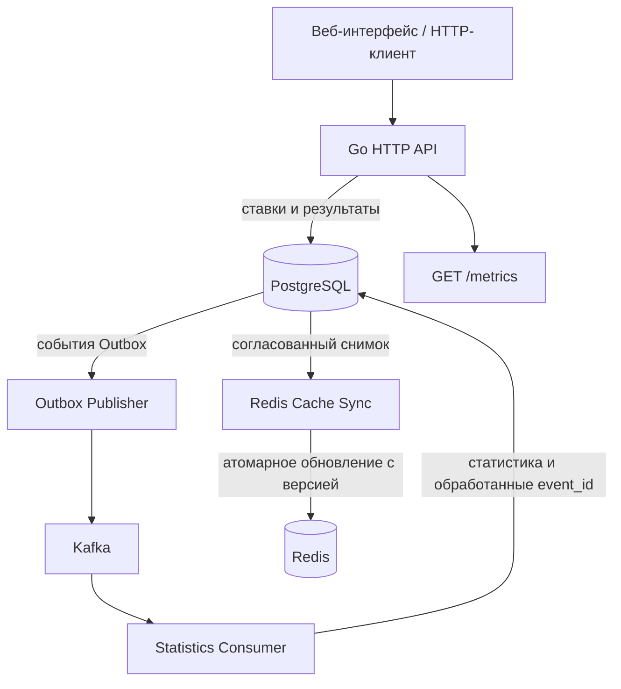

# Ad Auction Simulator

Это мой pet-проект на Go, в котором я разбираюсь, как работают рекламные аукционы и что нужно учитывать при разработке backend-сервиса с несколькими хранилищами и асинхронной обработкой событий.

Начинал я с простой задачи: принять ставки рекламодателей, учесть прогнозируемую вероятность клика (CTR) и определить победителя. По мере разработки добавил PostgreSQL, Redis, Kafka, Transactional Outbox, обработку отказов, автоматические проверки и отдельный процесс синхронизации кеша.

## Что умеет проект

- Принимать и проверять ставки через HTTP API.
- Поддерживать **first-price** и **second-price** аукционы.
- Выбирать победителя с учётом `predicted_ctr`.
- Хранить историю ставок и результатов в PostgreSQL.
- Отправлять события в Kafka через **Transactional Outbox**.
- Асинхронно рассчитывать статистику без повторного учёта дубликатов событий.
- Восстанавливать Redis-кеш из PostgreSQL.
- Запускаться через Docker Compose и проходить проверки в GitHub Actions.

## Технологии

| Технология | Для чего использую |
|---|---|
| **Go, `net/http`** | HTTP API и бизнес-логика |
| **PostgreSQL, `pgx`** | Основное хранилище, транзакции, история, Outbox и статистика |
| **Redis, `go-redis`** | Быстрый кеш ставок и результатов |
| **Apache Kafka, `kafka-go`** | Передача событий между процессами |
| **golang-migrate** | Версионированные SQL-миграции |
| **Docker Compose** | Запуск всей системы локально |
| **Prometheus client, pprof** | Метрики и профилирование |
| **testing, golangci-lint** | Тесты и статический анализ |
| **GitHub Actions** | Автоматические проверки и Docker build |

## Архитектура



У меня несколько отдельных Go-процессов:

**HTTP Server** принимает ставки и возвращает результаты. Он рассчитывает аукцион по данным PostgreSQL, а не Redis.

**Outbox Publisher** читает события, сохранённые вместе со ставками, и отправляет их в Kafka.

**Consumer** получает события из Kafka и обновляет статистику. Для защиты от повторного учёта использую уникальный `event_id` и таблицу `processed_events`.

**Cache Sync** периодически строит актуальное представление аукционов из PostgreSQL и обновляет Redis с проверкой версии снимка.

### Как обрабатывается ставка

1. Клиент отправляет `POST /bid`.
2. Сервис проверяет данные и начинает транзакцию PostgreSQL.
3. В транзакции проверяется состояние аукциона, сохраняется новая ставка и определяется победитель.
4. В этой же транзакции сохраняются результат и запись в `outbox_events`.
5. После `COMMIT` API возвращает ответ.
6. Publisher доставляет событие в Kafka, Consumer обновляет статистику.
7. Cache Sync переносит подтверждённое состояние в Redis.

Самое важное архитектурное решение для меня — **PostgreSQL как источник истины**. Redis теперь не определяет, принята ставка или нет: это кеш, который можно восстановить после сбоя.

## Как выбирается победитель

Использую эффективную ставку:

```text
effective_bid = bid × predicted_ctr
```

Побеждает рекламодатель с максимальным значением.

| Рекламодатель | Ставка | CTR | Эффективная ставка |
|---|---:|---:|---:|
| A | 150 | 0.05 | 7.5 |
| B | 100 | 0.10 | 10 |

В этом примере выигрывает **B**.

- **First-price:** победитель платит собственную ставку — `100`.
- **Second-price:** цена определяется второй эффективной ставкой: `7.5 / 0.10 = 75`.

Если конкурент только один, цена в моей модели second-price равна нулю — резервной цены пока нет. При равенстве эффективных ставок выигрывает рекламодатель с лексикографически меньшим идентификатором. Повторная ставка того же рекламодателя заменяет предыдущую **для расчёта**, но история сохраняется в PostgreSQL.

Тип аукциона задаётся `AUCTION_TYPE=first-price` или `AUCTION_TYPE=second-price`; в Compose по умолчанию используется второй вариант.

## Как запустить

Понадобятся Docker и Docker Compose. Для локальной разработки без контейнерной сборки — Go, совместимый с `go.mod`.

```bash
git clone https://github.com/EgorVarshutin05/Ad-Auction-Simulator.git
cd Ad-Auction-Simulator

docker compose up --build -d
docker compose ps -a
```

После запуска веб-интерфейс и HTTP API доступны по адресу **http://localhost:8080**.

Docker Compose поднимает PostgreSQL, Redis, Kafka, HTTP-сервис, Publisher, Consumer и Cache Sync. Миграции PostgreSQL и создание Kafka-топика выполняются служебными контейнерами.

Посмотреть логи:

```bash
docker compose logs -f server
docker compose logs -f cache-sync
docker compose logs -f outbox-publisher consumer
```

Остановить окружение:

```bash
docker compose down
```

Обычный `docker compose down` не удаляет данные в Docker volumes.

> Пароли и настройки в `compose.yaml` предназначены для локальной разработки, а не для публичного развёртывания.

## API

Базовый адрес: `http://localhost:8080`.

| Метод | Маршрут | Назначение |
|---|---|---|
| `POST` | `/bid` | Принять ставку и вернуть результат аукциона |
| `GET` | `/winner?auction_id=...` | Последний подтверждённый победитель |
| `GET` | `/stats?auction_id=...` | Статистика обработанных событий |
| `GET` | `/metrics` | Метрики Prometheus |

`auction_id` разделяет независимые аукционы. Если его не указать, используется `default`.

### Отправляю ставку

```bash
curl -i -X POST http://localhost:8080/bid \
  -H "Content-Type: application/json" \
  -d '{"auction_id":"demo-1","advertiser_id":"A","bid":150,"predicted_ctr":0.05}'
```

Если это первая ставка нового аукциона `second-price`, ответ будет `201 Created`:

```json
{
  "advertiser_id": "A",
  "bid": 150,
  "predicted_ctr": 0.05,
  "effective_bid": 7.5,
  "price": 0,
  "auction_type": "second-price"
}
```

Теперь добавляю второго участника:

```bash
curl -i -X POST http://localhost:8080/bid \
  -H "Content-Type: application/json" \
  -d '{"auction_id":"demo-1","advertiser_id":"B","bid":100,"predicted_ctr":0.1}'
```

В этом примере победит B с ценой `75`.

### Получаю победителя

```bash
curl -s "http://localhost:8080/winner?auction_id=demo-1"
```

```json
{
  "advertiser_id": "B",
  "bid": 100,
  "predicted_ctr": 0.1,
  "effective_bid": 10,
  "price": 75,
  "auction_type": "second-price"
}
```

### Проверяю статистику

```bash
curl -s "http://localhost:8080/stats?auction_id=demo-1"
```

После обработки обоих Kafka-событий Consumer вернёт примерно следующее:

```json
{
  "total_bids": 2,
  "times_leading_after_bid": {"A": 1, "B": 1},
  "wins_by_advertiser": {"A": 1, "B": 1}
}
```

Здесь «победы» — число случаев, когда рекламодатель был лидером **после очередной принятой ставки**, а не количество рекламных показов. Оба поля со статистикой лидерства сейчас содержат одинаковые данные. Статистика обновляется **асинхронно**, поэтому сразу после запроса может немного отставать.

Основные HTTP-статусы: `200` — успешное чтение, `201` — ставка принята, `400` — некорректные данные, `404` — пока нет результата, `405` — неподдерживаемый метод, `409` — конфликт состояния аукциона, `503` — временная ошибка необходимого хранилища.

## Почему я использую Outbox

Сначала кажется логичным: сохранил ставку в PostgreSQL, затем сразу отправил событие в Kafka. Но если между этими действиями сервис упадёт, ставка останется в базе, а событие потеряется.

Поэтому я записываю ставку, результат и Outbox-событие **в одной транзакции**. Publisher отдельно отправляет сохранённое событие в Kafka и только потом отмечает его опубликованным.

Такой подход не исключает дубликаты: доставка работает по принципу **at-least-once**. Поэтому Consumer хранит `event_id` обработанных сообщений и обновляет статистику в одной транзакции с регистрацией события. Повторно доставленное сообщение не должно увеличивать счётчики ещё раз.

## Как я работаю с отказами Redis и Kafka

Одна из самых интересных частей проекта для меня — специально останавливать сервисы и смотреть, что произойдёт.

**Kafka.** Я проверял сценарий, в котором брокер был недоступен во время `POST /bid`. Ставка успешно сохранялась, событие оставалось в Outbox, а после восстановления Kafka Publisher отправлял его и Consumer обновлял статистику.

**Redis.** Я остановил Redis и убедился, что API продолжает принимать ставки и возвращать победителя из PostgreSQL. После этого добавил отдельный `cache-sync`: он периодически получает актуальный снимок PostgreSQL и атомарно обновляет Redis, не позволяя старой версии перезаписать новую.

Для учебного проекта я выбрал простой периодический обход аукционов. Если объём данных вырастет, синхронизацию нужно будет сделать инкрементальной.

## Тестирование и качество кода

Проверяю алгоритмы аукциона, работу PostgreSQL, Redis и логику синхронизации. Для интеграционных тестов нужны запущенные PostgreSQL и Redis:

```bash
docker compose up -d postgres redis migrate
```

```bash
# Базовые тесты (часть Redis-тестов тоже требует живой Redis)
go test ./... -count=1

# Интеграционные тесты PostgreSQL
go test -tags=integration ./internal/storage -run TestPostgres -v -count=1

# Проверка синхронизации Redis
go test -tags=integration ./internal/cache -v -count=1

# Статический анализ
go vet ./...
golangci-lint run ./...
```

В GitHub Actions у меня настроены проверки при `push` и `pull request` в `main`: `gofmt`, `go vet`, `golangci-lint`, тесты, миграции PostgreSQL и сборка Docker-образа.

[Посмотреть GitHub Actions](https://github.com/EgorVarshutin05/Ad-Auction-Simulator/actions)

## Структура проекта

```text
cmd/
  server/             HTTP API
  consumer/           обработчик Kafka-событий
  outbox-publisher/   публикация событий из PostgreSQL
  cache-sync/         синхронизация Redis

internal/
  api/                HTTP-обработчики
  auction/            расчёт победителя и цены
  service/            бизнес-логика
  storage/            работа с PostgreSQL и Redis
  outbox/             Transactional Outbox
  kafka/              взаимодействие с Kafka
  consumer/           идемпотентная обработка событий
  cache/              синхронизация кеша
  metrics/            метрики Prometheus

migrations/            SQL-миграции
web/                   веб-интерфейс
.github/workflows/     CI
compose.yaml
Dockerfile
```

## Ограничения и дальнейшие идеи

Этот проект — учебная модель. В нём пока нет авторизации, ограничения частоты запросов, реальных рекламных кампаний и отдельных аукционных раундов. Для денежных величин используется `float64`, а в реальной системе я предпочёл бы более подходящее представление денег. HTTP-запросы пока не имеют отдельного идемпотентного ключа: если клиент не получил ответ, он может повторить уже принятую ставку. Kafka работает на одном брокере без репликации, а Redis-синхронизатор периодически обходит аукционы, а не получает только изменения.

Сейчас для меня важнее довести до надёжного состояния существующие механизмы, расширить тесты и разобраться с оставшимися компромиссами, чем добавлять технологии ради списка в резюме.

## Что мне дал этот проект

Я начинал с желания лучше понять Go и `net/http`, а в процессе столкнулся с задачами, которые не всегда видны в небольших учебных примерах: как не потерять событие, как обработать дубликат, что считать источником истины и как пережить недоступность внешнего сервиса.
