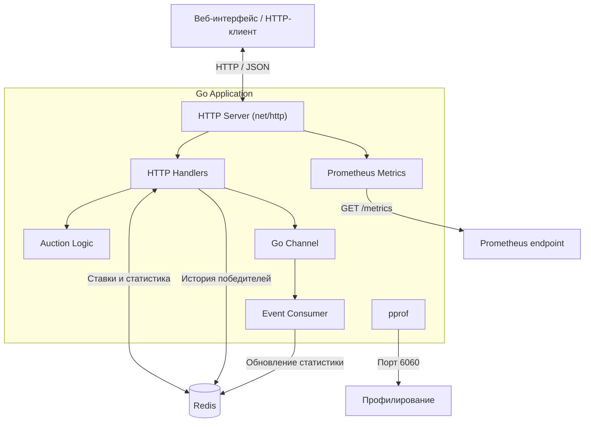

# Ad Auction Simulator

**Ad Auction Simulator** — учебный backend-проект на Go, моделирующий работу рекламного аукциона с учётом прогнозируемой вероятности клика (CTR).

Приложение реализует два типа аукционов — **First-Price** и **Second-Price**, определяет победителя на основе эффективной ставки (`bid × predicted_ctr`) и рассчитывает стоимость размещения рекламы.

Система предоставляет REST API для управления ставками и получения статистики. Для хранения данных используется **Redis**, для асинхронной обработки событий — **Go channels**, для сбора метрик — **Prometheus**, для профилирования — **pprof**.

## Стек технологий

| Технология | Назначение |
|---|---|
| **Go** | Основной язык разработки backend-приложения |
| **net/http** | HTTP-сервер и REST API |
| **Redis** | Хранение ставок, истории победителей и статистики |
| **Go channels** | Асинхронная передача событий между обработчиками и consumer |
| **Prometheus (client_golang)** | Сбор метрик HTTP-запросов и ставок |
| **pprof** | Профилирование CPU, памяти и goroutine |
| **Docker Compose** | Запуск Redis в контейнере |
| **HTML, CSS, JavaScript** | Веб-интерфейс для тестирования аукциона |
| **testing** | Unit-тестирование алгоритмов аукциона |

## Архитектура

Приложение построено как монолитный HTTP-сервис на Go. Компоненты разделены по ответственности: обработка HTTP-запросов, расчёт аукциона, хранение данных, обработка событий и сбор метрик.



### Основной процесс

1. Клиент отправляет ставку через `POST /bid`.
2. HTTP-обработчик проверяет входные данные и сохраняет ставку в Redis.
3. Модуль аукциона определяет победителя и рассчитывает цену размещения.
4. Результат сохраняется в Redis, а событие `bid_placed` отправляется в Go channel.
5. Отдельная goroutine обрабатывает событие и обновляет статистику в Redis.
6. Клиент получает результат через HTTP API. Метрики доступны через `/metrics`, профилирование — через `pprof`.

## Запуск

Требуется Go 1.23+, Docker с Compose.

```bash
docker compose up -d
go mod tidy
go run ./cmd/server
```

По умолчанию `AUCTION_TYPE=second-price`. Для первого типа:

```bash
AUCTION_TYPE=first-price go run ./cmd/server
```

## API

Приложение предоставляет HTTP API для отправки ставок, определения победителя аукциона и получения статистики.

Базовый адрес: `http://localhost:8080`

### Эндпоинты

| Метод | Эндпоинт | Описание |
|---|---|---|
| `POST` | `/bid` | Добавление или обновление ставки рекламодателя |
| `GET` | `/winner` | Получение текущего победителя аукциона |
| `GET` | `/stats` | Получение статистики ставок и побед |
| `GET` | `/metrics` | Метрики приложения в формате Prometheus |

### POST /bid

Принимает ставку рекламодателя, пересчитывает результат аукциона и возвращает информацию о победителе.

**Пример запроса:**

```json
{
  "advertiser_id": "A",
  "bid": 150,
  "predicted_ctr": 0.05
}
```

Поля запроса:

| Поле | Тип | Описание |
|---|---|---|
| `advertiser_id` | string | Идентификатор рекламодателя |
| `bid` | float64 | Ставка рекламодателя, больше 0 |
| `predicted_ctr` | float64 | Прогнозируемая вероятность клика, в диапазоне (0, 1] |

**Пример ответа (`201 Created`):**

```json
{
  "advertiser_id": "A",
  "bid": 150,
  "predicted_ctr": 0.05,
  "effective_bid": 7.5,
  "price": 0,
  "auction_type": "second-price"
}
```

Пример предполагает, что это первая ставка в аукционе. При отсутствии конкурентов цена во second-price аукционе равна нулю.

### GET /winner

Возвращает текущего победителя на основе сохранённых ставок.

**Пример ответа (`200 OK`):**

```json
{
  "advertiser_id": "B",
  "bid": 100,
  "predicted_ctr": 0.1,
  "effective_bid": 10,
  "price": 75,
  "auction_type": "second-price"
}
```

Пример предполагает наличие двух ставок: A (`150`, CTR `0.05`) и B (`100`, CTR `0.1`).

### GET /stats

Возвращает количество обработанных событий ставок и статистику побед рекламодателей.

Статистика обновляется асинхронно, поэтому результат может появляться с небольшой задержкой после `POST /bid`.

### GET /metrics

Предоставляет метрики приложения в формате Prometheus:

- `auction_http_requests_total` — количество HTTP-запросов.
- `auction_http_request_duration_seconds` — длительность обработки HTTP-запросов.
- `auction_bid_amount` — распределение величин принятых ставок.

### HTTP-коды ответов

| Код | Описание |
|---|---|
| `200 OK` | Успешное получение данных |
| `201 Created` | Ставка успешно принята |
| `400 Bad Request` | Некорректный JSON или параметры ставки |
| `404 Not Found` | Ставки ещё отсутствуют (`GET /winner`) |
| `405 Method Not Allowed` | Неподдерживаемый HTTP-метод |
| `500 Internal Server Error` | Ошибка расчёта аукциона |
| `503 Service Unavailable` | Redis недоступен или превышено время отправки события |


## Алгоритм аукциона

Победитель определяется на основе **эффективной ставки (eCPM-score)**, учитывающей размер ставки рекламодателя и прогнозируемую вероятность клика (CTR).

**Формула эффективной ставки:**

\[
EffectiveBid = Bid \times PredictedCTR
\]

Побеждает рекламодатель с максимальной эффективной ставкой.

### Типы аукционов

Реализованы два механизма ценообразования:

- **First-Price** — победитель платит собственную ставку.
- **Second-Price** — победитель платит минимальную ставку, необходимую для достижения эффективной ставки второго участника.

Для Second-Price стоимость рассчитывается по формуле:

\[
Price = \frac{EffectiveBid_{second}}{PredictedCTR_{winner}}
\]

### Пример расчёта

| Рекламодатель | Ставка | Predicted CTR | Эффективная ставка |
|---|---:|---:|---:|
| A | 150 | 0.05 | 7.5 |
| B | 100 | 0.10 | 10 |

Победитель — **рекламодатель B**, поскольку его эффективная ставка выше.

- **First-Price:** B платит `100`.
- **Second-Price:** B платит `7.5 / 0.10 = 75`.

### Особенности реализации

- Повторная ставка рекламодателя заменяет предыдущую.
- При равенстве эффективных ставок побеждает рекламодатель с лексикографически меньшим идентификатором.
- Если в Second-Price участвует только один рекламодатель, цена равна `0` (резервная цена отсутствует).
- Ставка должна быть положительной, а `predicted_ctr` — находиться в диапазоне `(0, 1]`.

## Хранение данных в Redis

Для хранения ставок, истории победителей и статистики используется **Redis** — in-memory хранилище данных типа «ключ — значение».

Взаимодействие с Redis реализовано через библиотеку `go-redis/v9`.

### Структуры данных

| Ключ | Тип Redis | Назначение |
|---|---|---|
| `auction:bids` | Hash | Хранение актуальной ставки каждого рекламодателя |
| `auction:winners` | List | История результатов аукциона |
| `auction:stats` | Hash | Общее количество обработанных ставок |
| `auction:wins` | Hash | Количество побед каждого рекламодателя |

### Используемые команды

| Команда | Назначение |
|---|---|
| `HSET` | Сохранение или обновление ставки рекламодателя |
| `HVALS` | Получение всех актуальных ставок |
| `LPUSH` | Добавление результата аукциона в историю |
| `HINCRBY` | Атомарное увеличение счётчиков статистики |
| `HGET` | Получение общего количества ставок |
| `HGETALL` | Получение статистики побед всех рекламодателей |

### Особенности хранения

- Ставки хранятся в формате JSON внутри Redis Hash. Ключом поля выступает `advertiser_id`.
- Повторная ставка рекламодателя перезаписывает предыдущую.
- История результатов аукциона хранится в Redis List, новые результаты добавляются в начало списка.
- Статистика обновляется асинхронно отдельным consumer через Go channel.
- Данные сохраняются между перезапусками Go-приложения, пока они остаются в Redis. Долговременная сохранность зависит от настроек персистентности Redis.

## 8. Асинхронная обработка событий

Для обработки событий используется буферизованный Go channel ёмкостью 100 сообщений.

При добавлении ставки:

1. HTTP-обработчик отправляет событие `bid_placed` в канал.
2. Отдельная goroutine (consumer) получает событие.
3. Consumer обновляет счётчики ставок и побед в Redis через `HINCRBY`.

Канал работает внутри одного процесса и не обеспечивает сохранность событий при аварийном завершении приложения.

## 9. Метрики и профилирование

Для мониторинга используется библиотека `prometheus/client_golang`.

Метрики доступны по адресу `http://localhost:8080/metrics`.

| Метрика | Тип | Назначение |
|---|---|---|
| `auction_http_requests_total` | Counter | Общее количество HTTP-запросов |
| `auction_http_request_duration_seconds` | Histogram | Время обработки HTTP-запросов |
| `auction_bid_amount` | Summary | Распределение принятых ставок |

Для профилирования используется `net/http/pprof` на `127.0.0.1:6060`.

Пример CPU-профилирования:

```bash
go tool pprof http://localhost:6060/debug/pprof/profile?seconds=10
```

## 10. Тестирование

Unit-тесты реализованы с помощью стандартного пакета `testing`.

Проверяемые сценарии:

- Определение победителя в First-Price.
- Расчёт стоимости в Second-Price.
- Учёт `predicted_ctr` при определении победителя.

Запуск тестов:

```bash
go test ./...
```

Проверка конкурентного доступа:

```bash
go test -race ./...
```

## 11. Ограничения реализации

Проект является учебной моделью рекламного аукциона и имеет следующие ограничения:

- Один непрерывный аукцион без отдельных раундов.
- Отсутствие авторизации и ограничений частоты запросов.
- Использование `float64` для денежных значений.
- События хранятся в оперативной памяти и могут теряться при сбое процесса.
- Отсутствие общей транзакции для сохранения ставки, результата и обновления статистики.
- `sync.Mutex` синхронизирует обработку ставок только внутри одного экземпляра приложения.
- Нет отдельного Kafka-брокера и развёрнутого Prometheus Server.

Для production-использования потребуются более надёжная обработка событий, распределённая синхронизация, дополнительная валидация и отказоустойчивость.